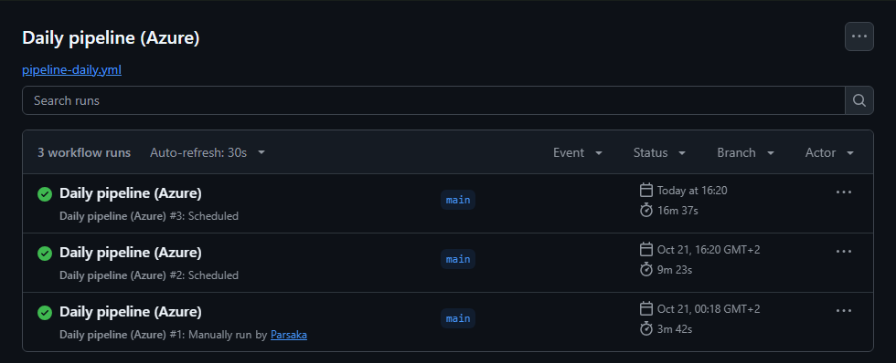
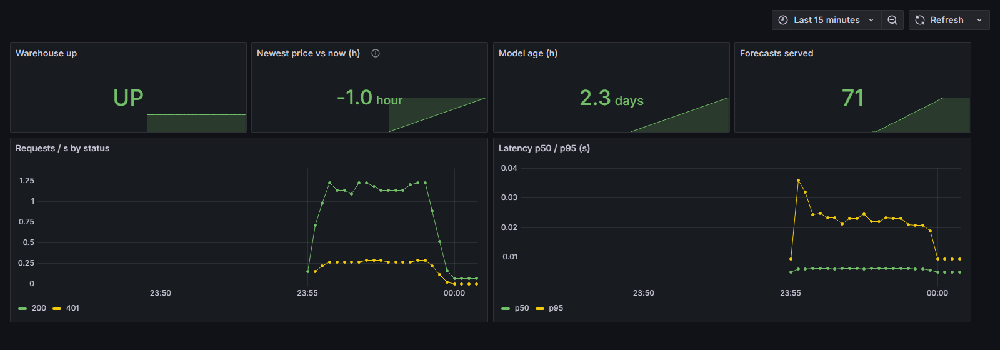
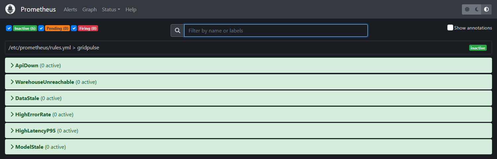
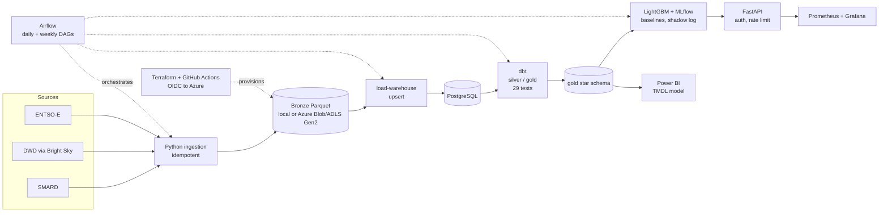
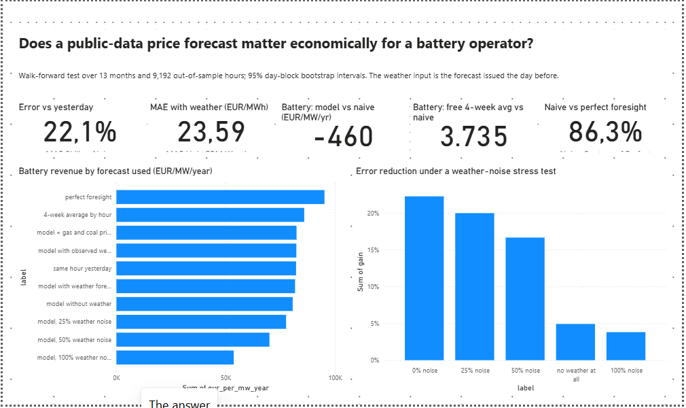

# GridPulse DE

[](https://github.com/Parsaka/gridpulse-de/actions/workflows/ci.yml)
[](https://github.com/Parsaka/gridpulse-de/actions/workflows/pipeline-daily.yml)
[](LICENSE)

**Open data on the German electricity market, turned into a price forecast, an honest answer to a
business question, and a pipeline that runs by itself in the cloud every day.**

A personal portfolio project (Parsa Kamali). Not trading or investment advice.

## In one minute

*The question:* is a day-ahead price forecast built only from public data good enough to be worth
money to a battery operator, compared with a very simple guess ("tomorrow looks like today")?

* The forecast **is** more accurate: its average error is **22% lower** than the guess
  (95% interval 17% to 26%), measured on 9,192 hours the model never saw, using the weather forecast
  that was really available the day before.
* That **did not make a small battery earn more**. Accuracy and decision value are different things.
* A free **4-week average by hour of day earned about 3,700 EUR more per MW and year** than the guess
  and more than the model, despite a worse error.
* **Gas explains the price level.** The gas price roughly doubled; that alone implies about
  +68 EUR/MWh against +70 measured at equal demand and renewables.
* For a **solar owner**, solar sells at about **54%** of the average price (26% in April 2026).
  A **flexible load** that runs in the cheapest 4 hours saves about **56%** of its energy cost.


Read more: [plain-language summary](docs/for-business.md) · [full analysis](docs/analysis.md) ·
[interactive dashboard](docs/analysis/dashboard.html) (download and open) ·
[model card](docs/model-card.md) · [how it runs in the cloud](docs/cloud.md) · [changelog](CHANGELOG.md)

## What is inside

| Part | What it does | Details |
|---|---|---|
| Ingestion | SMARD, DWD, Open-Meteo, ENTSO-E clients into idempotent Parquet | [data sources](docs/data-sources.md) |
| Warehouse | PostgreSQL + dbt star schema, 29 data tests, source freshness | [dbt/](dbt/) |
| Model | LightGBM predicting the change versus yesterday; shadow-mode forecast log | [model card](docs/model-card.md) |
| Orchestration | Airflow DAGs locally; scheduled GitHub Actions in the cloud | [cloud](docs/cloud.md) |
| Serving | FastAPI with auth, rate limit, Prometheus, Grafana, alerts | [runbook](docs/runbook.md) |
| Infrastructure | Terraform on Azure (data lake, Key Vault, logging, budget), OIDC CI/CD | [azure setup](docs/azure-setup.md) |
| Analysis | Walk-forward evaluation, battery dispatch, factors, gas, calibration | [analysis](docs/analysis.md) |
| BI | Power BI model and 5-page report as text in Git, checked in Desktop | [Power BI](docs/powerbi.md) |

## Status and honest limits
* Verified: CI (7 jobs) green; the daily and weekly cloud workflows ran successfully on 2026-10-21;
  the Power BI report opened in Desktop with real data.
* The cloud jobs use a throw-away Postgres; the API is **not hosted 24/7**.
* **Live check, so far negative:** First scored shadow hours (21 and 22 Oct 2026, 48 hours): model MAE 70.1 against 53.5 EUR/MWh for yesterday's price (skill -31%). That is two days at record price levels (about 200 EUR/MWh), far too few to judge, and it does not confirm the walk-forward result (+22% over 9,192 hours); it is reported as measured and the log keeps growing.
* No carbon price; gas price is monthly; one market, about two years of data.

## Screenshots (from the running system)

**Cloud:** the daily pipeline on GitHub Actions (two runs started by the cron trigger on their own,
one by hand; the shown duration includes GitHub's queue time, the work itself takes about 4 minutes).



**Monitoring:** Grafana API health and the six Prometheus alert rules (all inactive while healthy).




**Orchestration (local):** the Airflow daily DAG, all tasks green.


Power BI report pages are in [docs/powerbi.md](docs/powerbi.md).

## Quick start

```bash
python -m venv .venv && . .venv/bin/activate   # Windows: .venv\Scripts\activate
pip install -e ".[dev]"
gridpulse smard --start 2025-01-01 --end 2025-01-08 --dataset price_day_ahead
gridpulse weather --start 2025-01-01 --end 2025-01-08
pytest
```

Data lands in `data/bronze/<source>/<dataset>/date=YYYY-MM-DD/part.parquet`. Re-running a day
overwrites that partition (idempotent), so backfills and retries are safe.

## Architecture



**In the cloud (verified 2026-10-21, Azure for Students, Sweden Central):** Terraform created the
ADLS Gen2 data lake (`bronze` and `state` containers), Key Vault, Log Analytics and a budget alert.
Two scheduled GitHub Actions workflows (OIDC, no stored secret) run the real pipeline against it
with a throw-away Postgres: a **daily** run (ingest, dbt build and tests, tomorrow's forecast, scoring
of earlier forecasts) and a **weekly retrain** that publishes a model only if it beats the naive
baseline. The first real runs took about 8 minutes (retrain) and 4 minutes (daily) and succeeded;
see [docs/cloud.md](docs/cloud.md). **Locally** you can still run everything: Airflow, Postgres, dbt,
training and the API ([docs/deploy.md](docs/deploy.md), [docs/azure-setup.md](docs/azure-setup.md)).
No service runs 24/7 (the API is not hosted).

Data sources and licences: [docs/data-sources.md](docs/data-sources.md). Decisions: [docs/adr](docs/adr).

## Run with Airflow (local)

```bash
docker compose --profile airflow up -d --build   # UI: http://localhost:8080 (admin / admin, local only)
```

- `gridpulse_daily` (05:00 UTC): SMARD + DWD with a 3-day lookback, retries with exponential backoff,
  failure callback, and a row-count check so silent empty loads fail loudly.
- `gridpulse_backfill`: manual run with `start`/`end` params; idempotent, so safe to repeat.

## Warehouse and dbt (local)

```bash
docker compose up -d postgres
pip install -e ".[warehouse,dbt]"
gridpulse load-warehouse                 # bronze Parquet -> Postgres schema `bronze` (upsert)
cd dbt && export DBT_PROFILES_DIR=. && dbt deps && dbt build
dbt source freshness && dbt docs generate && dbt docs serve
```

Layers: `bronze` (raw, loaded) ? `silver` (typed, deduplicated views, seed `locations`) ?
`gold` (`fct_market_hourly`, `fct_weather_hourly`, `dim_datetime`, `dim_location`). Facts are
incremental with a 3-day reprocessing window because SMARD revises recent values.
CI runs `dbt build` against a Postgres service using deterministic **synthetic** data
(`gridpulse sample-data`), so no network is needed.

## Price model

```bash
pip install -e ".[warehouse,ml]"
gridpulse train --test-days 90      # baselines + LightGBM, logs to MLflow, writes gold.price_forecast_backtest
```

Evaluated walk-forward over 13 months (monthly retraining, 9,192 out-of-sample hours), LightGBM
with the weather forecast issued the day before (Open-Meteo archive) reaches MAE 23.6 vs 30.3
EUR/MWh for "same hour yesterday": **22% lower (95% interval 17% to 26%)**. Observed weather would
give the same (23.5), so the forecast loses almost nothing; adding last month's gas and coal prices
gives 22.6 (25%). Details and limits:
[docs/model-card.md](docs/model-card.md).

## Analysis: does the forecast matter economically?

Central question: *is a day-ahead forecast built from public data good enough, versus the naive
"same hour yesterday", to matter for a battery operator, and which market conditions decide where
it wins or fails?* Plain-language one-pager for non-technical readers: [docs/for-business.md](docs/for-business.md). Full write-up with method, tables and limitations:
[docs/analysis.md](docs/analysis.md) and an interactive
[dashboard](docs/analysis/dashboard.html) (download and open in a browser).

| Finding | Number (95% interval) |
|---|---|
| Forecast error vs yesterday, walk-forward, real day-before weather forecast | 22% lower (17% to 26%), 12 of 13 months better |
| Battery revenue vs naive forecast (1 MW / 2 MWh) | -460 EUR/MW/year (-2,588 to +1,707): **no measurable difference** |
| A free 4-week average by hour vs naive forecast | **+3,735 EUR/MW/year (+1,894 to +5,685)**, also above the model (+4,194), despite a *worse* MAE |
| Weather model vs naive at 1 h / 4 h battery | **-1,315 (-2,639 to -80, worse)** / **+3,826 (+1,433 to +6,279)** |
| Naive forecast as share of perfect-foresight revenue | 86% |
| Price at equal residual load, Aug-Oct 2026 vs 2025 | +70 EUR/MWh (65 to 75) |
| Negative-price chance when residual load <= 8 GW | 67% (2025) to 41% (2026) |
| Nominal 80% forecast interval, actual coverage | 69% as trained, 79% after rolling conformal calibration |
| Gas explains the +70 EUR/MWh price gap | gas 11.1 to 23.3 USD/mmbtu; 5.6 EUR/MWh per USD/mmbtu (3.3 to 6.8, R2 0.76) implies +68 |
| Price effect of 1 GW more wind / solar | -3.0 / -3.3 EUR/MWh (wind and solar explain 31 of the 67 points of price variation explained) |
| Model gain in winter vs spring | 4% (interval includes zero) vs 32% |
| Solar owner: price received vs average | 54% overall, 26% in April 2026 |
| Flexible load in the cheapest 4 hours | 56% lower energy cost than running flat |


Takeaway: accuracy and decision value are different things. The most accurate forecast is not the
one that earns the most, because a battery needs the ranking of hours, not the price level.

Reproduce: `gridpulse walk-forward --first-test-month 2025-10-01 --n-months 13 && gridpulse analyze`.

## API and monitoring

```bash
gridpulse train && docker compose --profile monitoring up -d --build
curl -H "X-API-Key: dev-local-key" http://localhost:8000/v1/forecast
```

`/health`, `/ready`, `/v1/prices`, `/v1/forecast` (next-day hourly prices from a DWD MOSMIX weather
forecast), `/metrics` for Prometheus. Alert rules, Grafana dashboard, the measured load test and a
documented failure drill are in [docs/runbook.md](docs/runbook.md). The forecast is a portfolio
demo, not trading advice; see the [model card](docs/model-card.md) for its limits.

## Power BI

Semantic model (TMDL, 24 DAX measures, star schema over the gold tables) and a 5-page, 34-visual
report (PBIR, schema-validated) in [powerbi/](powerbi/). Opened and checked in Power BI Desktop with
real data (no account or password: `gridpulse export-bi`, then open the PBIP); screenshots and
limits in [docs/powerbi.md](docs/powerbi.md).



## Licence and data attribution

Code and documentation: MIT, see [LICENSE](LICENSE). Data keeps its publishers' licences.

> Contains data from Bundesnetzagentur | SMARD.de (CC BY 4.0) and Deutscher Wetterdienst
> (CC BY 4.0, via Bright Sky). Quelle: Deutscher Wetterdienst. Data was aggregated and combined by
> GridPulse DE; changes are not endorsed by the publishers.

Verification status of each source's terms: [docs/data-sources.md](docs/data-sources.md).
