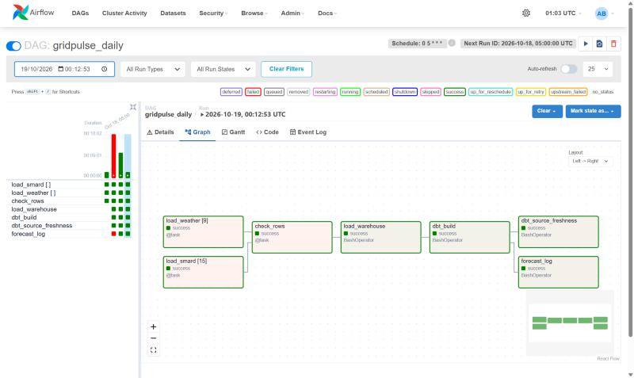
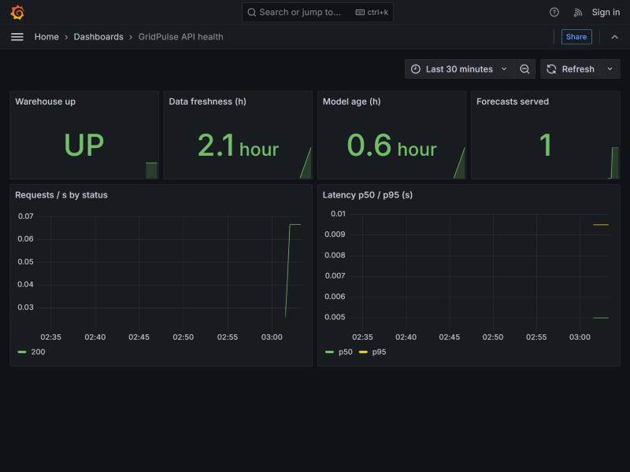
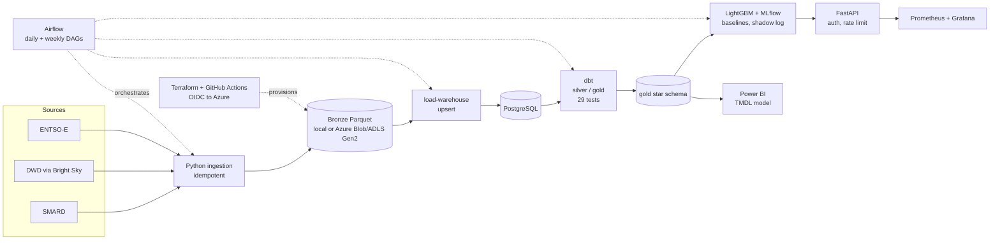

# GridPulse DE

Data and forecasting platform for the German electricity market: open data (SMARD, ENTSO-E, DWD)
→ Parquet bronze → dbt models → price/load forecasts → API → Power BI. Built on Azure with
Terraform, Airflow and GitHub Actions.

> Personal portfolio project. Status: **Phases 1–2 (ingestion, Airflow) done**; see [roadmap](docs/roadmap.md).

## Screenshots (from the running system)

| Airflow: daily DAG, all tasks green | Grafana: API health dashboard |
|---|---|
|  |  |

## Quick start

```bash
python -m venv .venv && . .venv/bin/activate   # Windows: .venv\Scripts\activate
pip install -e ".[dev]"
gridpulse smard --start 2025-01-01 --end 2025-01-08 --dataset price_day_ahead
gridpulse weather --start 2025-01-01 --end 2025-01-08
pytest
```

Data lands in `data/bronze/<source>/<dataset>/date=YYYY-MM-DD/part.parquet`. Re-running a day
overwrites that partition (idempotent), so backfills and retries are safe.

## Architecture



Run locally: ingestion, Airflow, PostgreSQL, dbt, training and the API. Deployed to Azure (verified
2026-10-20, Azure for Students, Sweden Central): the ADLS Gen2 data lake, Key Vault, Log Analytics and
a budget alert, created by Terraform; the pipeline writes to and reads from that real storage
account. Compute (Airflow, Postgres, API) does not run in Azure yet; see
[docs/azure-setup.md](docs/azure-setup.md) and [docs/deploy.md](docs/deploy.md).

Data sources and licences: [docs/data-sources.md](docs/data-sources.md). Decisions: [docs/adr](docs/adr).

## Run with Airflow (local)

```bash
docker compose --profile airflow up -d --build   # UI: http://localhost:8080 (admin / admin, local only)
```

- `gridpulse_daily` (05:00 UTC): SMARD + DWD with a 3-day lookback, retries with exponential backoff,
  failure callback, and a row-count check so silent empty loads fail loudly.
- `gridpulse_backfill`: manual run with `start`/`end` params; idempotent, so safe to repeat.

## Warehouse and dbt (local)

```bash
docker compose up -d postgres
pip install -e ".[warehouse,dbt]"
gridpulse load-warehouse                 # bronze Parquet -> Postgres schema `bronze` (upsert)
cd dbt && export DBT_PROFILES_DIR=. && dbt deps && dbt build
dbt source freshness && dbt docs generate && dbt docs serve
```

Layers: `bronze` (raw, loaded) ? `silver` (typed, deduplicated views, seed `locations`) ?
`gold` (`fct_market_hourly`, `fct_weather_hourly`, `dim_datetime`, `dim_location`). Facts are
incremental with a 3-day reprocessing window because SMARD revises recent values.
CI runs `dbt build` against a Postgres service using deterministic **synthetic** data
(`gridpulse sample-data`), so no network is needed.

## Price model

```bash
pip install -e ".[warehouse,ml]"
gridpulse train --test-days 90      # baselines + LightGBM, logs to MLflow, writes gold.price_forecast_backtest
```

Evaluated walk-forward over 13 months (monthly retraining, 9,192 out-of-sample hours), LightGBM
with weather inputs reaches MAE 23.5 vs 30.3 EUR/MWh for "same hour yesterday": **22% lower
(95% interval 18% to 26%)**. That uses observed weather as a forecast proxy, so it is an upper
bound (see the noise test in the analysis). Details and limits:
[docs/model-card.md](docs/model-card.md).

## Analysis: does the forecast matter economically?

Central question: *is a day-ahead forecast built from public data good enough, versus the naive
"same hour yesterday", to matter for a battery operator, and which market conditions decide where
it wins or fails?* Plain-language one-pager for non-technical readers: [docs/for-business.md](docs/for-business.md). Full write-up with method, tables and limitations:
[docs/analysis.md](docs/analysis.md) and an interactive
[dashboard](docs/analysis/dashboard.html) (download and open in a browser).

| Finding | Number (95% interval) |
|---|---|
| Forecast error vs yesterday, walk-forward | 22% lower (18% to 26%), 12 of 13 months better |
| Battery revenue vs naive forecast (1 MW / 2 MWh) | +128 EUR/MW/year (-1,945 to +2,263): **no measurable difference** |
| A free 4-week average by hour vs naive forecast | **+3,735 EUR/MW/year (+1,894 to +5,685)**, also above the model (+3,606), despite a *worse* MAE |
| Weather model vs naive at 1 h / 4 h battery | -1,161 (spans zero) / **+4,000 (+1,635 to +6,414)** |
| Naive forecast as share of perfect-foresight revenue | 86% |
| Price at equal residual load, Aug-Oct 2026 vs 2025 | +70 EUR/MWh (65 to 75) |
| Negative-price chance when residual load <= 8 GW | 67% (2025) to 41% (2026) |
| Nominal 80% forecast interval, actual coverage | 70% |
| Price effect of 1 GW more wind / solar | -3.0 / -3.3 EUR/MWh (wind and solar explain 31 of the 67 points of price variation explained) |
| Model gain in winter vs spring | 6% (interval includes zero) vs 33% |
| Solar owner: price received vs average | 54% overall, 26% in April 2026 |
| Flexible load in the cheapest 4 hours | 56% lower energy cost than running flat |


Takeaway: accuracy and decision value are different things. The most accurate forecast is not the
one that earns the most, because a battery needs the ranking of hours, not the price level.

Reproduce: `gridpulse walk-forward --first-test-month 2025-10-01 --n-months 13 && gridpulse analyze`.

## API and monitoring

```bash
gridpulse train && docker compose --profile monitoring up -d --build
curl -H "X-API-Key: dev-local-key" http://localhost:8000/v1/forecast
```

`/health`, `/ready`, `/v1/prices`, `/v1/forecast` (next-day hourly prices from a DWD MOSMIX weather
forecast), `/metrics` for Prometheus. Alert rules, Grafana dashboard, the measured load test and a
documented failure drill are in [docs/runbook.md](docs/runbook.md). The forecast is a portfolio
demo, not trading advice; see the [model card](docs/model-card.md) for its limits.

## Power BI

Semantic model (TMDL, 24 DAX measures, star schema over the gold tables) and a 5-page, 34-visual report (PBIR, schema-validated) in
[powerbi/](powerbi/), with setup, page designs and limits in [docs/powerbi.md](docs/powerbi.md).

## Licence and data attribution

Code and documentation: MIT, see [LICENSE](LICENSE). Data keeps its publishers' licences.

> Contains data from Bundesnetzagentur | SMARD.de (CC BY 4.0) and Deutscher Wetterdienst
> (CC BY 4.0, via Bright Sky). Quelle: Deutscher Wetterdienst. Data was aggregated and combined by
> GridPulse DE; changes are not endorsed by the publishers.

Verification status of each source's terms: [docs/data-sources.md](docs/data-sources.md).
