# Does a public-data price forecast matter economically? A full analysis

> Generated by `gridpulse analyze` from `17,520` hourly day-ahead prices
> (2024-10-19 to 2026-10-18) and `9,192` out-of-sample
> forecast hours. Do not edit by hand: change the code and regenerate.
> Intervals are 95% day-block bootstrap intervals unless stated otherwise.
> An interactive version is in [`analysis/dashboard.html`](analysis/dashboard.html).

## The question

**Is a one-day-ahead price forecast built from public data good enough, compared with the naive 'same hour yesterday', to matter economically for a battery operator, and which market conditions decide where it wins or fails?**

It is a decision question rather than a modelling one. A forecast is only worth building if acting
on it earns more than the free alternative, and the answer can differ by market condition.
Four sub-questions follow from it, each answered below with one method:

1. What kind of market is this, and has it changed? (price level at equal conditions)
2. When do prices go negative or spike, and are those events forecastable?
3. Is the model statistically better than the naive forecast, and where?
4. Does that improvement turn into money for a battery operator?

## Short answer

| | Result | Evidence |
|---|---|---|
| Statistically better? | **Yes.** Mean absolute error 23.5 vs 30.3 EUR/MWh, 22% lower | 95% interval 18% to 26%; better in 12 of 13 months |
| Economically better? | **No measurable difference.** Battery revenue +128 EUR/MW/year vs the naive forecast | interval -1,945 to +2,263, spans zero |
| A free alternative? | **Yes, and it wins.** A plain average of the last 4 weeks by hour of day earns +3,735 EUR/MW/year more than yesterday's price and +3,606 more than the model | intervals +1,894 to +5,685 and +2,041 to +5,235; its MAE is *worse* (31.8) |
| Does battery size change it? | **Yes.** At 1 h it is no better (-1,161, interval -2,483 to +69), at 4 h it wins (+4,000, interval +1,635 to +6,414) | Section 4 |
| Why not at 2 h? | Dispatch needs the ranking of hours, and the model does not rank the expensive hours better than yesterday (62% vs 62% top-3 hit rate); yesterday already earns 86% of the ceiling | Section 4 |
| Is the model well calibrated? | **No.** The nominal 80% interval covers 70% | Section 3 |
| Caveat that matters most | The weather model is fed *observed* weather, i.e. a perfect weather forecast. It is an upper bound | Section 3, noise test |

The honest conclusion: the accuracy gain is real, but for a 2 MWh battery it buys nothing, and a free
4-week average beats both yesterday and the model. The forecast only starts to pay for longer storage,
and even there the free average keeps up. The most useful finding is about the yardstick: accuracy
and decision value are different things.

## 1. The market moved: same conditions, much higher prices

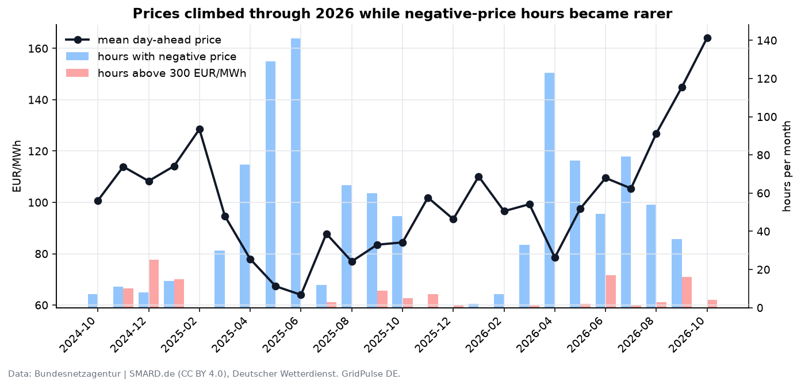

For August to mid-October, 2026 against 2025, at the **same residual load** (demand minus wind
and solar) and the same hour of day, the price is **+70 EUR/MWh higher**
(interval 65 to 75). The average price went from
84 to 142 EUR/MWh while average residual load fell
from 26.8 to 23.2 GW, so load and renewables
do not explain it. Over a full year the gap is smaller (+22, interval
18 to 26) and it widens month by month:
04: +15, 05: +27, 06: +34, 07: +38, 08: +63, 09: +68 EUR/MWh (April to September).

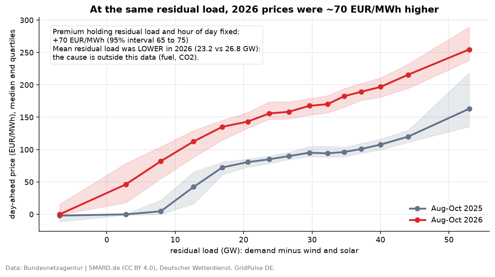

The gap is not uniform. In hours with strongly negative residual load (the lowest bin of the curve,
below 0 GW) prices sit near zero in both years (median -1.98 in 2025 and
0.00 in 2026): the premium lives in the hours where fossil plants set the price.

This pattern points to the fuel and carbon price level, which the platform does not observe.
**This is a statement about what is *not* explained by load and renewables, not a measured cause.**

The slope is 3.4 EUR/MWh per GW of residual load
(interval 3.2 to 3.7): each additional GW the
fossil fleet has to cover raises the price by about that much.

## 2. Negative prices and spikes

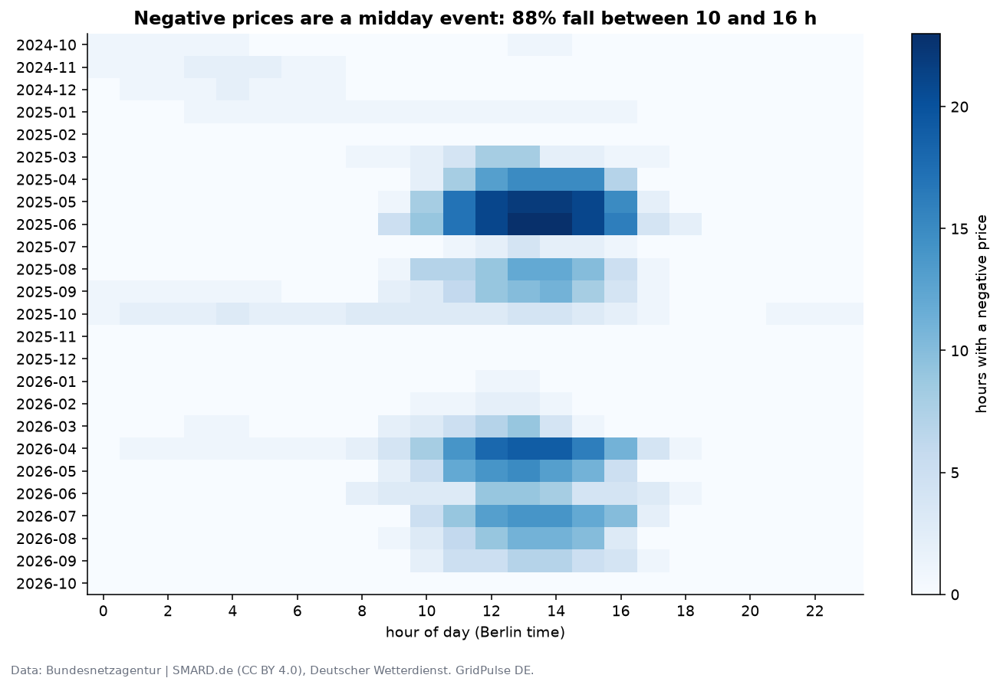

1,059 hours (6.0%) had a negative price.
88% of them fall between 10:00 and 16:59 Berlin time, and
57% on weekends against a weekend share of
29% of all hours. Average solar output in negative hours is
33 GW against
7 GW otherwise, while wind is almost the same
(16 vs
15 GW): a sunny weekend midday is the trigger.

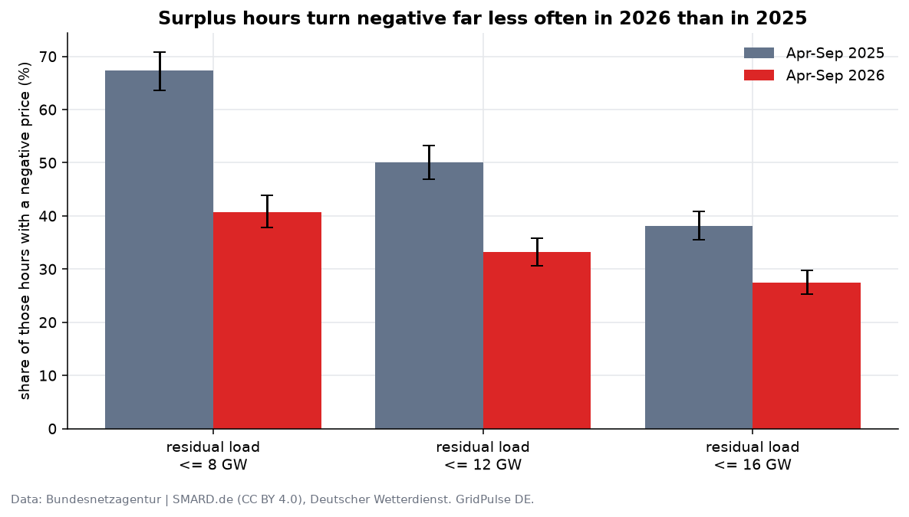

Negative prices became **less likely at the same surplus**. When residual load was at or below
8 GW (April to September), the share of negative hours fell from
67% (interval 64% to 71%) in 2025 to
41% (38% to 44%) in 2026. Something
absorbs the surplus better (more storage, flexible demand, or curtailment rules); the data cannot
say which.

Price spikes above 300 EUR/MWh: 119 hours, 65% of them
in the evening, with average residual load 58 GW against
29 GW otherwise and only 3.2 GW of wind
against 15.5 GW: dark, calm evenings.

## 3. Forecast quality

Method: walk-forward evaluation. For each of 13 months, the model is trained on
all earlier data only (plus a 60-day validation block), then predicts that month. The target is the
change from the same hour yesterday. Result tables are over 9,192 hours
(383 days).

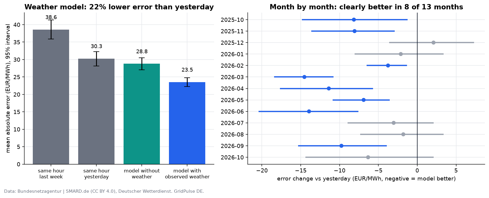

| Model | MAE (EUR/MWh) | vs same hour yesterday |
|---|---|---|
| Same hour last week | 38.6 | -28% (-38% to -18%) |
| **Same hour yesterday (baseline)** | **30.3** | |
| 4-week average by hour (no model) | 31.8 | -4.9% (-12.6% to 1.7%) |
| Model without weather | 28.8 | 4.9% (-0.2% to 9.4%) |
| Model with observed weather | **23.5** | **22%** (18% to 26%) |

Weather is what makes the model work: without it the gain is 4.9% and
the interval includes zero. With it, 12 of 13 months are better than the baseline
(8 of them with an interval that excludes zero); the remaining months are not distinguishable
or slightly worse, so the gain is not uniform.

**The weather in this model is observed, not forecast.** To see how much that flatters the result,
Gaussian noise (a share of each weather variable's standard deviation) was added to the weather
inputs at prediction time. This is illustrative, not a calibrated forecast-error model:

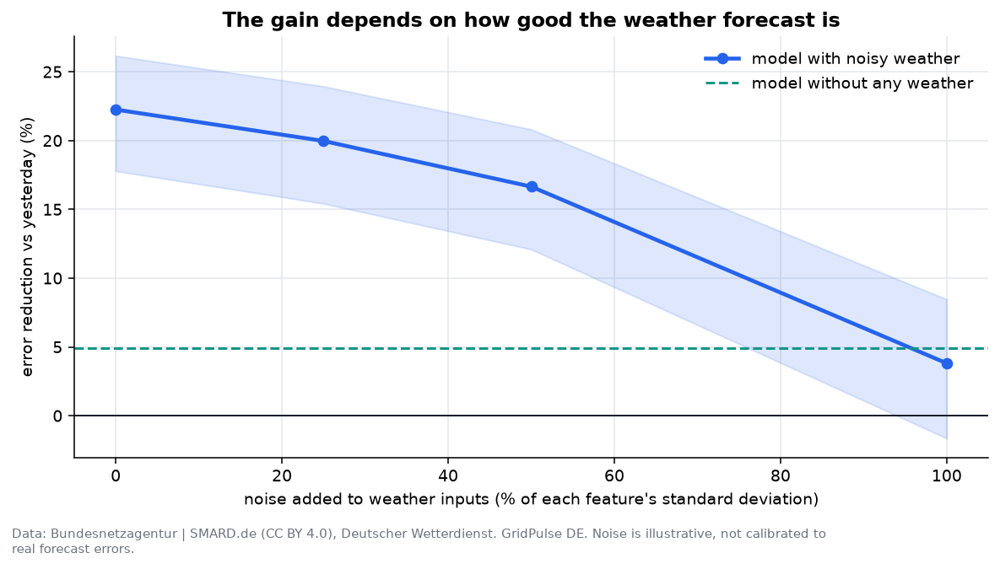

| Noise | MAE | Gain vs yesterday |
|---|---|---|
| 0% of std | 23.5 | 22% (18% to 26%) |
| 25% of std | 24.2 | 20% (15% to 24%) |
| 50% of std | 25.2 | 17% (12% to 21%) |
| 100% of std | 29.1 | 4% (-2% to 8%) |

At 100% noise the gain shrinks to 3.8%, no better than having no weather
at all. The real-world gain therefore lies between those numbers and the headline.

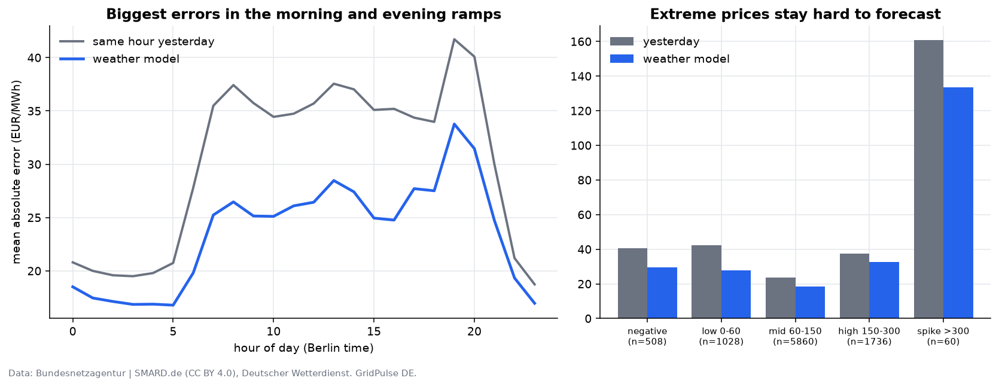

**Where it wins and loses.** (Regimes are defined by the realised price, so these splits condition on
the outcome: extreme prices look worse partly by construction. Read them as a description of where
errors sit, not as a forecastable risk.) The relative gain is largest in the low 0-60 price
regime (35% lower error). In
spikes above 300 EUR/MWh the model still misses by 133 EUR/MWh on
average (60 hours): it improves on the baseline but remains unreliable exactly where it
would matter.

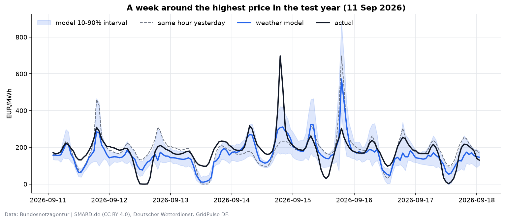

**Uncertainty is understated.** The model's 10 to 90% interval is meant to cover 80% of hours; it
covers 70%. The worst regime is spike >300 (32%,
60 hours). The model is too confident; the regime split conditions on the realised price, so its low coverage in
spikes is partly by construction, but the overall 70% is not.

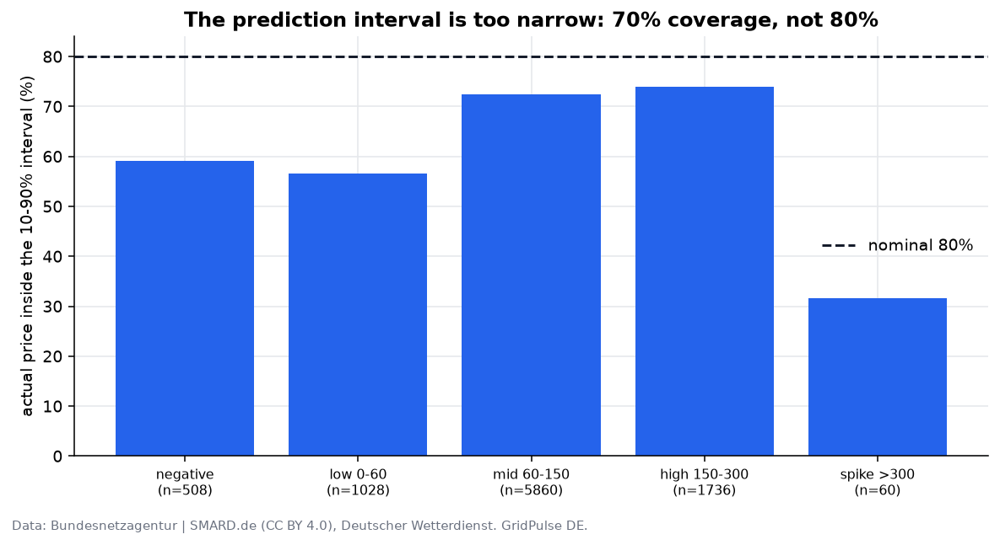

## 4. Does it earn money?

Setup: a 1 MW / 2 MWh battery, round-trip efficiency
88%, 3 EUR/MWh
degradation cost, one cycle per day on the day-ahead market, scheduled by an exact linear programme
from each forecast and paid at the **actual** price. Perfect foresight is the ceiling.

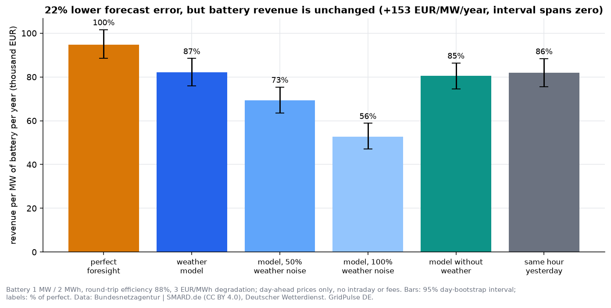

| Strategy | EUR/MW/year | Share of perfect foresight |
|---|---|---|
| perfect foresight | 95,165 (88,901 to 102,102) | 100% |
| same hour yesterday | 82,167 (75,784 to 88,698) | 86% |
| model without weather | 80,624 (74,603 to 86,629) | 85% |
| 4-week average by hour | 85,901 (79,633 to 92,612) | 90% |
| model with observed weather | 82,295 (76,098 to 88,686) | 86% |
| model, 25% weather noise | 77,602 (71,650 to 83,643) | 82% |
| model, 50% weather noise | 69,993 (64,187 to 76,393) | 74% |
| model, 100% weather noise | 53,657 (48,164 to 59,726) | 56% |

Over 382 days the weather model earns +128 EUR/MW/year more than yesterday's
price (interval -1,945 to +2,263), and the model without weather -1,543
(-3,498 to +288). **A 22% lower forecast error does not move battery
revenue at 2 MWh.** With noisy weather the model falls clearly *below* the naive forecast
(69,993 EUR/MW/year at 50% noise).

### The cheapest forecast wins

A plain average of the last 4 weeks, by hour of day, needs no model and no weather. Its error is
*larger* than yesterday's (31.8 against 30.3 EUR/MWh) but it earns
+3,735 EUR/MW/year more than yesterday's price (interval +1,894 to +5,685) and
+3,606 more than the weather model (interval +2,041 to +5,235). A battery needs the *ranking* of
hours within a day, not the price level. Consistent with that, the average puts 67%
of each day's three most expensive hours in its own top three, against
62% for the weather model and 62% for yesterday
(mean within-day rank correlation 0.84, 0.84 and
0.78). The model removes level error that the schedule does not use.
This is an explanation consistent with the data, not a proven mechanism.

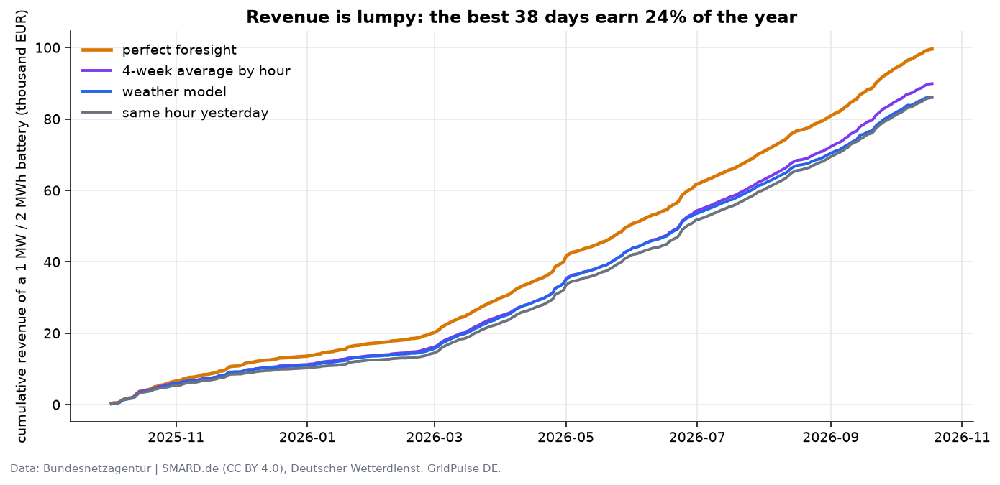

Revenue is lumpy: the best 38 days earn 24% of the
perfect-foresight total, and the weather model beats yesterday on only
43% of days, with gains (5,645 EUR) and
losses (-5,511 EUR) almost cancelling over the period.

### Does battery size change the answer?

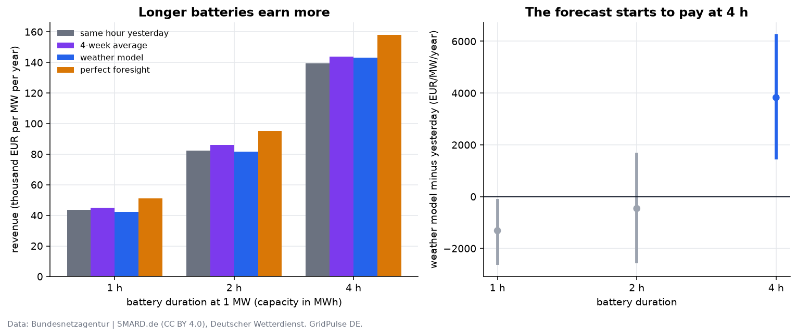

Yes. Holding power at 1 MW and varying capacity:

| Duration | Yesterday | 4-week average | Weather model | Perfect | Model minus yesterday |
|---|---|---|---|---|---|
| 1 h | 43,599 | 45,066 | 42,439 | 50,969 | -1,161 (-2,483 to +69) |
| 2 h | 82,167 | 85,901 | 82,295 | 95,165 | +128 (-1,862 to +2,404) |
| 4 h | 139,333 | 143,845 | 143,333 | 158,155 | +4,000 (+1,635 to +6,414) |

The longer the storage, the more hours there are to rank and the more a good forecast is worth. At
4 h the model is clearly better than yesterday, but the free 4-week average is as good
as the model (143,845 against 143,333). The 2 MWh case used above is one
point on this curve.

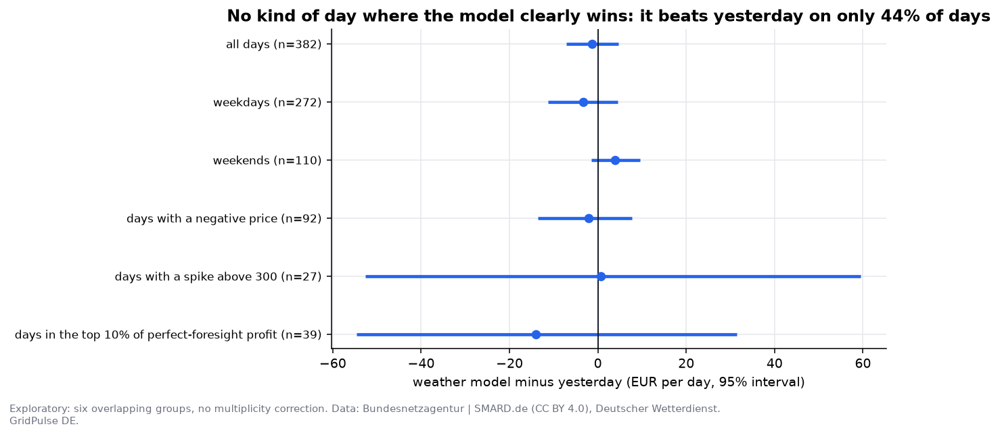

By kind of day (exploratory, six overlapping groups, no correction for multiple comparisons) there
is no group where the model's advantage over yesterday is clear at 2 MWh.

## 5. What drives prices, and when the forecast wins or loses

### 5.1 The weather effect on the price

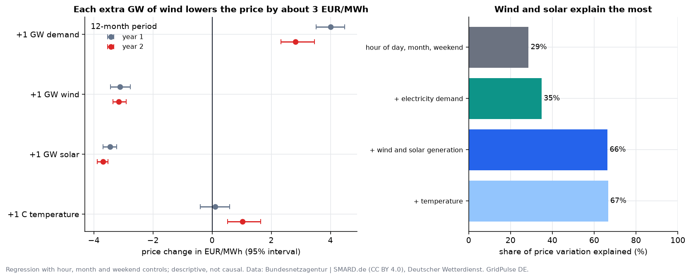

Holding hour of day, month and weekend fixed, **one more GW of wind lowers the day-ahead price by
3.0 EUR/MWh** (interval -3.2 to -2.8), one more GW of solar by
3.3 (-3.5 to -3.1), and one more GW of demand raises it by
3.8 (3.4 to 4.2). The wind and solar effects are almost identical in the two
12-month periods; the demand effect weakened in the second. Temperature adds little once
demand is known (+1.0 EUR/MWh per degree, and about zero in the first year):
it matters through heating and cooling demand, not directly.

Wind and solar generation are the biggest single driver: hour, month and weekend explain
29% of the variation in price, adding demand brings it to
35%, adding wind and solar to 66%, and temperature
to 67%. This is a descriptive regression, not a causal estimate.

### 5.2 Weather situations

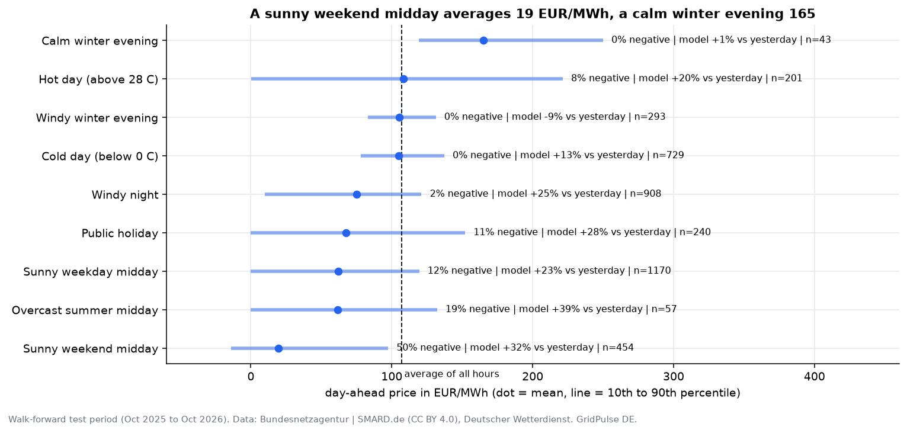

| Situation | Hours | Mean price | Negative | Above 200 | Model vs yesterday |
|---|---|---|---|---|---|
| Sunny weekend midday | 454 | 19 | 50% | 0% | 32% |
| Sunny weekday midday | 1170 | 62 | 12% | 0% | 23% |
| Windy night | 908 | 75 | 2% | 0% | 25% |
| Calm winter evening | 43 | 165 | 0% | 21% | 1% |
| Windy winter evening | 293 | 105 | 0% | 0% | -9% |
| Cold day (below 0 C) | 729 | 105 | 0% | 1% | 13% |
| Hot day (above 28 C) | 201 | 108 | 8% | 14% | 20% |
| Public holiday | 240 | 67 | 11% | 2% | 28% |
| Overcast summer midday | 57 | 62 | 19% | 0% | 39% |
| All hours | 9192 | 107 | 6% | 5% | 22% |

A sunny weekend midday is the cheapest situation in the data (mean 19 EUR/MWh,
50% of hours negative); a calm winter evening is the most expensive
(mean 165, 21% of hours above 200). Hot days
are volatile (14% of hours above 200 and 8% negative, only 201 hours); cold days are stable and predictable.

### 5.3 When the model works better and worse

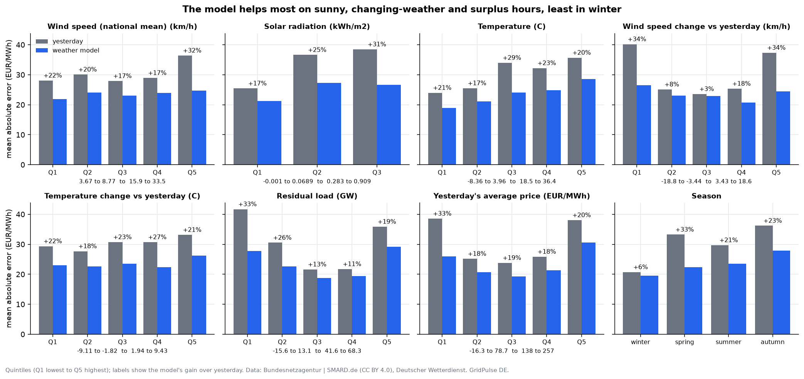

* **Best:** Wind speed change vs yesterday 3.43 to 18.6 (34% lower error than yesterday); spring
  (33%); hours with strong or sunny weather; and hours where the weather
  *changes* from yesterday: with the largest wind change in either direction the gain is
  34% and 34%. The model's job is to notice what yesterday does not know.
* **Worst:** winter (gain 6%, interval -10% to 18%, which includes
  zero) and days when the weather is the same as yesterday (middle wind-change bin: gain
  3%). When nothing changes, "same as yesterday" is hard to beat. In windy winter
  evenings the model is slightly *worse* than yesterday (-9%, 293 hours).
* **Largest absolute errors** are in the morning and evening ramps, in hours with high solar
  output, in surplus hours (residual load below 13 GW: MAE 28 against
  19 in the middle of the range) and the day after an unusual day.
* **Not clearly better than yesterday (interval includes zero):** Wind speed change vs yesterday -0.989 to 1.08; Yesterday's price volatility 1.16 to 18.3; Season winter.
* **Weekends and public holidays** are no worse than normal days for the model
  (weekend 24%, holiday 28% with only 240 hours).

### 5.4 How it fails

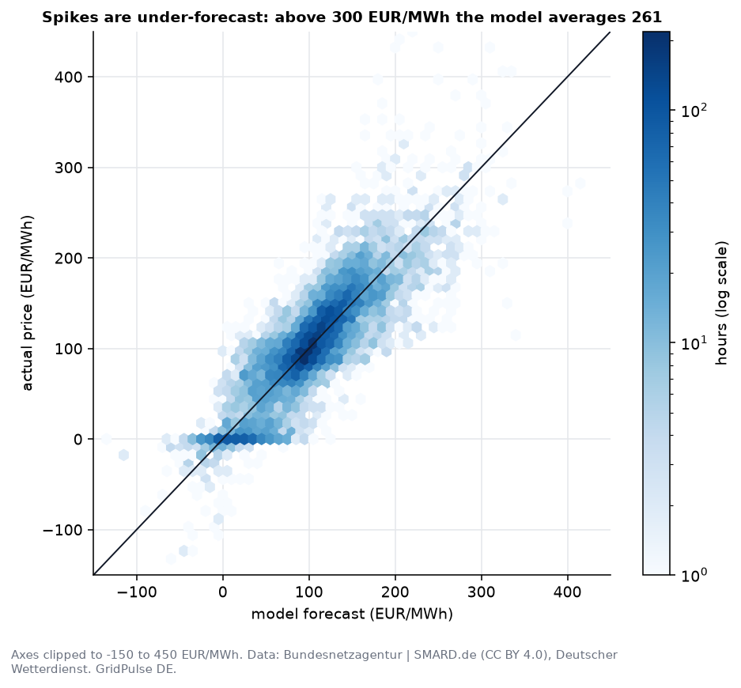

Only 1.5% of hours have an error above 100 EUR/MWh, but the worst 1% of hours
cause 7.5% of all error. They fall into two kinds:

1. **Spikes are under-forecast.** On 14 September 2026 at 19:00 local time the price hit
   697 EUR/MWh with 1.9 GW of wind and 56 GW of residual load; the model said
   298, yesterday's price said 230.
2. **Extremes are copied into the next day.** The lowest price in the data (-499 EUR/MWh, 1 May 2026, a holiday with a
   solar surplus) was forecast as -47. The following day the model and the naive
   forecast both predicted around -456 to -490 again, while the real price was only -87 to -130. A
   model that anchors on yesterday inherits yesterday's outliers.

### 5.5 Odd-looking results, checked

| Observation | Check | Verdict |
|---|---|---|
| Negative price while demand is high? | 0 hours with a negative price and residual load above 25 GW | Consistent: negative prices only occur in surplus hours |
| Price spike while supply is ample? | 0 hours above 250 EUR/MWh with residual load below 20 GW | Consistent |
| Price of -499 EUR/MWh | 1 May 2026 (public holiday) at midday, residual load -8.3 GW, close to the -500 EUR/MWh minimum of the coupled day-ahead market (a market rule, not derived from this data) | Real, extreme, explained by holiday plus solar surplus |
| Many prices exactly around zero | 455 hours (2.6%) within 0.1 EUR/MWh of zero | Plausible market behaviour (renewables often bid near zero); not verified here |
| Prices higher although residual load fell | 2026 vs 2025 at equal conditions (+70 EUR/MWh) | Likely fuel and carbon prices, not in the data |
| Temperature effect differs between years | +0.1 vs +1.0 EUR/MWh per degree | Weak and unstable: do not rely on it |
| Noisy-weather model worse than no-weather model | 100% noise gain 3.8% vs 4.9% | Expected: the model learned to trust weather |
| Missing data | 4 hours without residual load, 46 without weather | Left as missing, never filled; excluded where needed |
| Jumps | 2 hour-to-hour changes above 300 EUR/MWh | Rare; kept in the data, they coincide with the extreme hours |

None of the checks found data that contradicts the physics of the market. What they found are
behaviours that look odd but are real, and the model weaknesses listed above.

## 6. What this means for business

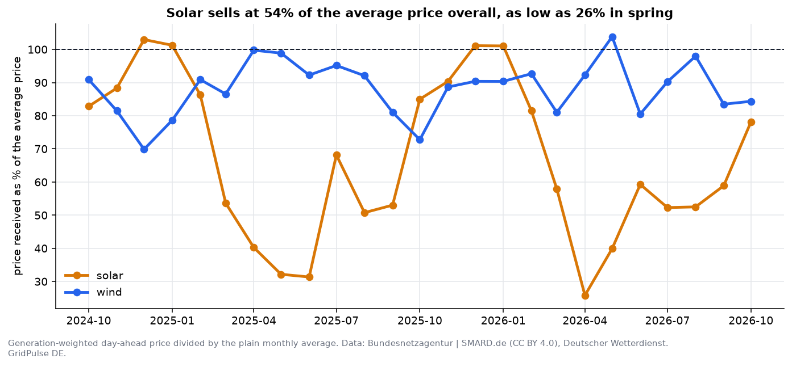

| Who | Finding | Number |
|---|---|---|
| Solar owner | Solar sells below the average price, and the gap is widest in spring | Solar earns 54% of the average price over the period, only 26% in 2026-04; wind earns 88% |
| Industrial or EV load with flexibility | Run in the cheapest hours instead of flat | Cheapest 4 hours cost 44 vs 100 EUR/MWh flat: 56% saving, about 56 EUR/MWh |
| Battery operator | Earnings are seasonal and lumpy; a simple average beats the model at 2 MWh | Best month 2026-09: 447 EUR/day, worst 2025-12: 87 (perfect foresight) |
| Anyone buying power | Price risk sits in a few evening hours with little wind | 65% of the 119 spike hours are in the evening; mean wind 3.2 GW against 15.5 |
| Forecast users | Trust the forecast most when the weather changes; check it when nothing changes and after an extreme day | Gain 34% (big fall in wind) and 34% (big rise) vs 3% in stable weather |

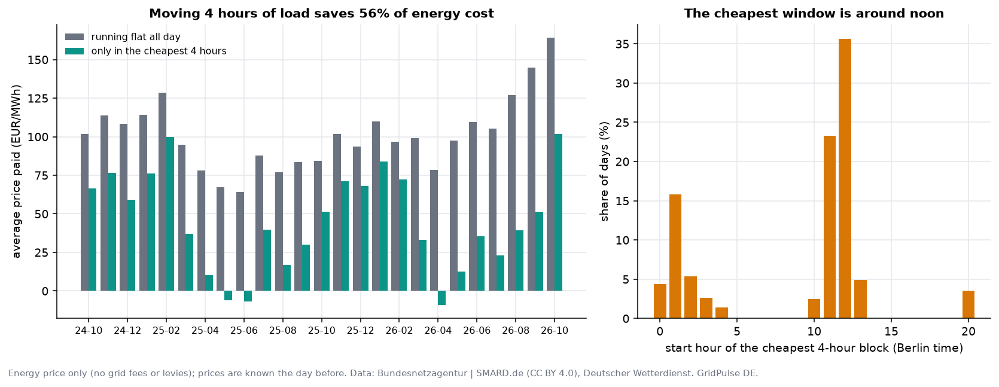

A flexible consumer does not need a forecast: day-ahead prices are published the day before.
The cheapest block of four hours starts at 11:00 or 12:00 on 66% of days, which is consistent with solar driving the saving.
If one MW of load can run those four hours instead of staying flat, the energy cost falls by
about 56 EUR per MWh moved, roughly 82,467 EUR per MW and year before grid
charges and levies.

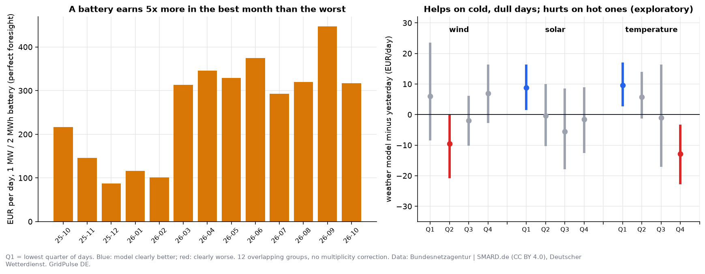

Battery earnings follow the season: 5.1 times higher in the best month than in the worst.
The weather model helps most on cold, dull days (about +10 EUR per day over yesterday)
and loses on hot days (-13); these day groups are exploratory.

For a non-technical reader: the weather decides the price, solar and wind push it down by roughly
3 EUR/MWh per GW, evenings with no wind are where the money and the risk are, and
a plain average of recent prices is a surprisingly strong planning tool.

## What this means

* The forecasting work is sound and honestly measured: a 22% lower error
  than the obvious benchmark, over 13 strictly out-of-sample months.
* For a short (2 MWh per MW) day-ahead battery the model is not worth running: a free 4-week
  average earns more. Its value appears for longer storage (4 h), where it matches the
  free average, so even there the simple option is the benchmark to beat.
* Accuracy is the wrong yardstick for dispatch: the forecast with the worst error earned the most
  among the three practical options. Evaluate forecasts by the decision they feed.
* The market itself is the larger story: prices at equal physical conditions are
  70 EUR/MWh higher, negative prices are less likely, and spikes are
  concentrated in dark, low-wind evenings.

## Limitations

* The weather model uses observed weather. Real use needs a numerical weather forecast, which this
  project does not have (see the noise test for the effect).
* One market, roughly two years of prices, one battery configuration. No intraday, balancing or
  ancillary revenue, no network charges, no capacity degradation over time.
* The price premium is a regression residual, not a causal estimate; fuel and carbon prices are not
  in the data.
* Quantile intervals are not conformally calibrated; coverage is reported, not fixed.
* The battery bootstrap resamples days independently; day-to-day dependence is ignored. The size
  and day-type comparisons are exploratory, with no multiplicity correction.
* The dispatch model is an exact linear programme under stated physics (no ramp limits, fixed
  efficiency, no price impact). Perfect-foresight revenue is a ceiling, not an expectation.
* The factor tables are many comparisons on one year of data; treat single bins as hints. Scenario
  samples can be small (for example 43 calm winter evening hours).
* Capture rates and flexible-load savings use day-ahead energy prices only: no grid fees, levies,
  taxes or contract terms.
* Past results; not trading or investment advice.

## Reproduce

```bash
pip install -e ".[dev,viz]"
gridpulse walk-forward --first-test-month 2025-10-01 --n-months 13   # about 20 min on a laptop
gridpulse analyze                                                      # figures, dashboard, this file
```

Data: SMARD.de (Bundesnetzagentur, CC BY 4.0) and Deutscher Wetterdienst via Bright Sky (CC BY 4.0).
See [data-sources.md](data-sources.md).
