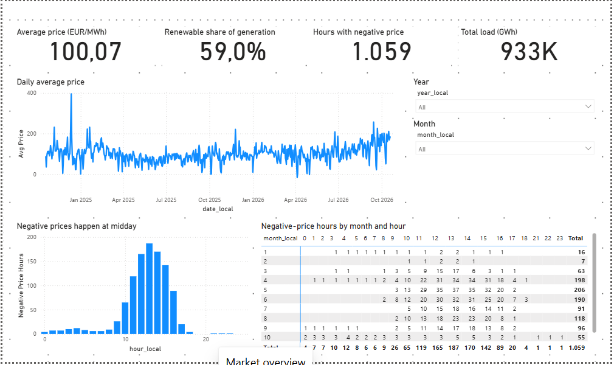
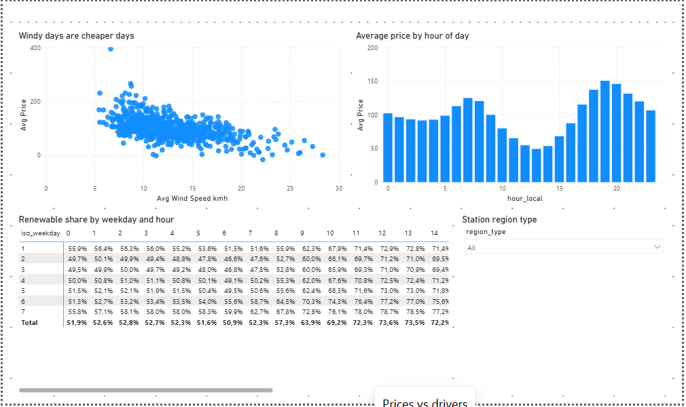
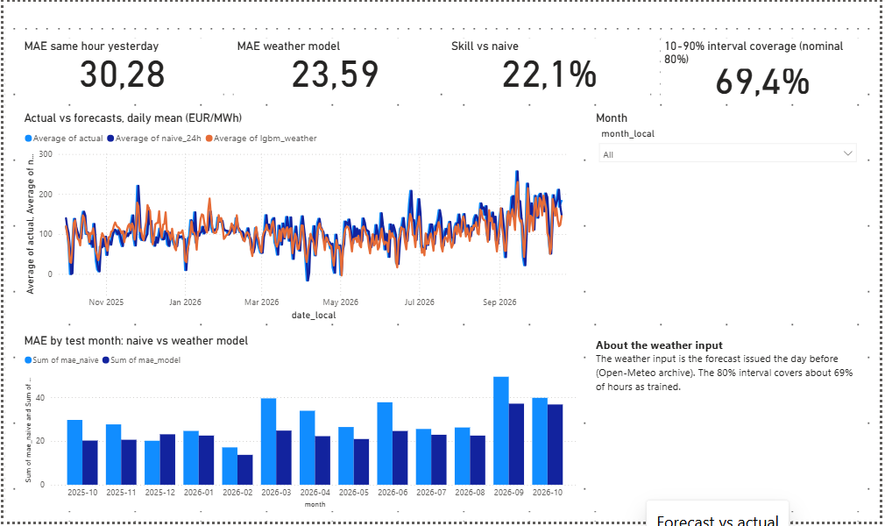
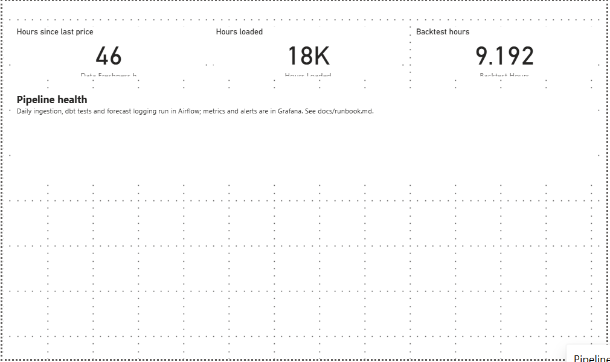

# Power BI

The semantic model lives in Git as text (PBIP + TMDL), so changes are reviewable and tested.

```
powerbi/
  GridPulse.pbip                      open this in Power BI Desktop
  GridPulse.SemanticModel/definition/ TMDL: 8 tables, 24 DAX measures, 4 relationships, 1 parameter (CsvFolder)
  GridPulse.Report/                   report: 5 pages, 34 visuals bound to the model (generated by scripts/gen_pbir.py)
scripts/gen_tmdl.py                   regenerates the TMDL (a test fails if the committed files drift)
scripts/validate_tmdl.ps1             loads the TMDL with Power BI Desktop's own parser (Windows)
```

## Open it (no account, no password)
1. Create the CSV files the model reads: with the warehouse filled (`docker compose up -d postgres`,
   `gridpulse load-warehouse`, `cd dbt && dbt build`, `gridpulse walk-forward --first-test-month
   2025-10-01 --n-months 13`, `gridpulse analyze`), run `gridpulse export-bi`. It writes one CSV per
   model table to `data/bi/`.
2. Open `powerbi/GridPulse.pbip` in Power BI Desktop. Click **Apply changes** if the yellow bar
   appears, then **Refresh**. The data source is a plain file folder, so Desktop asks for nothing.
   The folder is the parameter `CsvFolder` (default `C:\Users\Parsa\Documents\gridpulse-de\data\bi\`);
   if the repo lives elsewhere, change it under Transform data > Edit parameters.
3. Optional, direct database import: `python scripts/gen_tmdl.py --source postgres` rewrites the model
   to read the `gold` schema (parameters `PgServer`, `PgDatabase`). Desktop then asks for the
   database login: this is the local PostgreSQL in Docker (user `gridpulse`, password in
   `docker-compose.yml`), not a Power BI or Microsoft account. Switch back with
   `python scripts/gen_tmdl.py`.
4. The report definition (5 pages, 34 visuals) is generated by `scripts/gen_pbir.py` and committed.
   Save changes made in Desktop as PBIP so they go to Git.

## Pages
| Page | Content |
|---|---|
| The answer | The central question, four KPI cards (error vs naive, MAE, battery revenue vs naive, naive capture of perfect foresight), battery revenue by forecast, error reduction under weather noise |
| Market overview | Cards, daily price line, month and year slicers, negative prices by hour and a month x hour matrix |
| Prices vs drivers | Wind vs price scatter, price by hour, renewable share by weekday x hour, region slicer |
| Forecast vs actual | MAE cards, interval coverage, actual vs naive vs weather model, MAE by test month, caveat text |
| Pipeline health | Freshness and row-count cards |

Note on the forecast page: the weather model uses the weather forecast issued the day before
(see [model-card.md](model-card.md)).

## Screenshots (Power BI Desktop 2.156, data refreshed from the CSV export)






## Status and limits
- **Verified in Desktop** (version 2.156.951.0, 26.07): the model loads, all five pages render with
  data, and the numbers match the analysis exactly (1,059 negative-price hours, MAE 30.28 and 23.59,
  skill 22.1%, battery -460 and +3,735 EUR/MW/year, 86.3% naive capture, 9,192 backtest hours).
  Checked by driving Desktop through Windows UI Automation and screenshots, not by a person.
- **Found only by loading it in Desktop:** the first model used a measure property (`description:`)
  that Power BI's own TMDL parser rejects; schema validation and unit tests had passed.
  `scripts/validate_tmdl.ps1` now loads the model with Desktop's own library (Windows with
  Desktop installed). Slicers also started with the first item selected; they are now dropdowns
  that start on "All".
- Checked without Power BI: tests verify measure metadata, relationships, DAX column references,
  generator sync, that every visual binds only existing tables, columns and measures, and that the
  CSV partition of every table exists. The report JSON is validated against Microsoft's PBIR
  schemas (`python scripts/validate_pbir.py`, needs network).
- Not verified: publishing to the Power BI service (needs an account; the data would have to be
  re-pointed away from a local folder), other Desktop versions, and visual formatting beyond
  defaults (no colour theme, no conditional formatting on the matrices).
- Time-intelligence measures are not included; the model has no marked date table yet.
